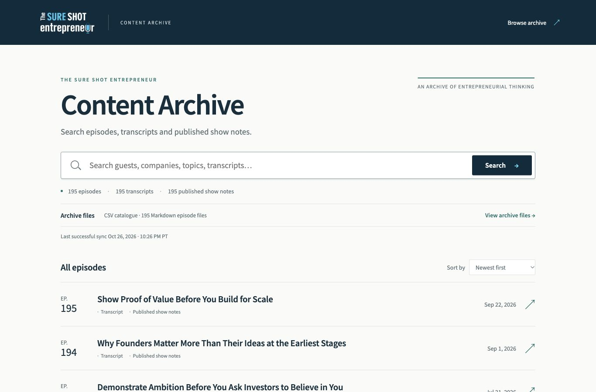

# Weekly synchronization validation

Validated locally on 27 October 2026. The production command, workflow and frontend freshness treatment are implemented. Remote activation is pending review: no commit, push, scheduled GitHub run or deployment was performed. [Operational guide](archive-weekly-sync.md).

## Real official-source check

The final live check began at `2026-10-27T05:26:02.538687+00:00` and successfully completed at `2026-10-27T05:26:17.109254+00:00`. Its Pacific display is **Oct 26, 2026 · 10:26 PM PT**. This is a real manual production synchronization, not a claimed Tuesday scheduled run.

| Result | Observed value |
| --- | --- |
| Published episodes | 195 |
| New / changed / unchanged / not seen | 0 / 0 / 195 / 0 |
| Official catalogue discovery requests | 3 |
| Episode-detail requests | 0 |
| Transcripts / published notes / Markdown files | 195 / 195 / 195 |
| Timestamped transcripts | 116 |
| Search index | Validated and reused |
| ZIP | 195 members; 3,918,604 bytes; reused |
| Pending source fields | None |
| Content, exports, index and ZIP hashes/mtimes | Unchanged |
| Files whose hash or mtime changed | `sync-status.json`, `reports/sync-run.json` only |

Before/after evidence compares all 2,031 local archive files. The successful timestamp advanced from `2026-10-26T14:37:16.142638+00:00`; the browser then reloaded and displayed the new persisted value on both homepage and Archive Files. The catalogue/manifest fingerprint stayed `b9d92b946df226eea1438d2dbae3a493a2b1d76de68fa943b8eeb8439a887893`.

The first live orchestration check earlier in this task reconciled three archive records/provenance entries without fetching episode details or changing CSV/Markdown/ZIP bytes. Subsequent live checks reported zero changed records. This is not evidence of three official transcript corrections; the fixture tests separately prove correction handling.

Machine-readable evidence: [live sync and footprint](screenshots/archive-sync/live-sync-validation.json), [freshness/browser layout checks](screenshots/archive-sync/freshness-validation.json), [browser regression checks](screenshots/archive-sync/browser-regression.json).

## Isolated production scenarios

All synthetic Episode 196 content was created in temporary directories and removed with its fixtures. The real archive remains the official 195-episode collection.

| Scenario | Verified behavior |
| --- | --- |
| No-change week | 0 new, 0 changed, 195 unchanged; 3 catalogue requests, 0 detail requests; unchanged content bytes/Markdown mtimes; reused index; advanced success timestamp; real temporary Git repository creates no commit |
| Episode 196, full sources | One new episode; frontend/catalogue/CSV/Markdown counts reach 196; browsable record and Episode File work; unique transcript text is searchable; ZIP contains its UUID Markdown file; count and success timestamp advance |
| Episode 196, transcript pending | 196 published and Markdown records, 195 transcripts; explicit `unavailable_at_source` in file/manifest; next production check retries it, ingests the available transcript with one detail request, and makes its text searchable |
| Historical correction | One changed episode, 194 unchanged; corrected metadata/transcript propagate to derived sources and search; previous source payload retained; neighboring Markdown bytes unchanged |
| Silent source correction | Bounded refresh detects a correction without a catalogue revision and updates search |
| Unavailable or malformed source | Catalogue outage, invalid catalogue, detail transport error, missing transcript field and malformed transcript type abort; accepted archive bytes and previous success metadata identical |
| Generated-output failure | Export, search rebuild, ZIP generation, validation and ordinary promotion failures abort with complete prior-state preservation |
| Git persistence | Real isolated Git commit and local bare-remote push include only allowed content; unrelated files and operational timestamp excluded; commit/push failures propagate instead of reporting success |
| Fresh checkout | Deleting ignored index, corpus, ZIP and validation caches is recoverable from accepted sources; coverage/search/ZIP validate, without changing success timestamp |
| Status artifact restoration | Only successful matching state accepted; failed, other-generation, expired and older evidence cannot replace the local success |

## Automated checks

Commands used:

```sh
python3 -B -m unittest discover -s tests/archive -v
python3 -B -m unittest discover -s tests/frontend -v
node tests/frontend/sync-status-unit.mjs
```

The final results are recorded in [test results](screenshots/archive-sync/test-results.json). The suite covers 113 archive tests and 14 HTTP tests. The Node presentation test exercises five Pacific winter/summer/DST dates and two absent/failed-state cases. A separate Python schedule test checks Tuesday local time around both DST transitions, and workflow ordering tests assert validation/tests → Git persistence → successful artifact upload.

Through the documented CUA browser interface:

- 28 existing archive browser regression checks passed, including search, filters, full-source fidelity, deep links/reload, source labels and responsive readers.
- 26 freshness/layout checks passed at 1366×900 desktop, 768×1024 tablet and 375×812 mobile, plus one actual before/after no-change timestamp check: **27 passed**.
- Both pages read the exact persisted UTC timestamp and display its Pacific conversion; coverage matches persisted episode count; Archive Files is keyboard reachable; individual episode pages avoid repeated status; no horizontal overflow, browser warnings or console errors.
- Screenshots were visually inspected at all three sizes. Search and file access retain their prominence; freshness uses small muted text. An initial browser-test selector typo was corrected, then the full freshness suite passed. Desktop screenshots use explicit clipping to avoid the browser panel cropping a larger test viewport.

No unresolved test failure remains. The local sandbox initially blocked network/listening sockets; approved execution permitted the live source check and loopback tests. These were environment constraints, not accepted partial synchronization results.

## Final screenshots



[Homepage tablet](screenshots/archive-sync/home-tablet.jpg) · [Homepage mobile](screenshots/archive-sync/home-mobile.jpg) · [Archive Files desktop](screenshots/archive-sync/files-desktop.jpg) · [Archive Files tablet](screenshots/archive-sync/files-tablet.jpg) · [Archive Files mobile](screenshots/archive-sync/files-mobile.jpg).

## Operational boundary

The selected content baseline is 56.84 MiB across 2,012 files, while the local archive including rebuildable artifacts is 178.63 MiB. Automatic content commits use an explicit allowlist. Successful operational state is a separate 90-day Actions artifact, including on no-change weeks. The actual workflow permissions, scheduler support and action commit pins were inspected; repository settings were not changed.

The implementation supports automatic weekly archive synchronization, but the archive **cannot yet be described as actively synchronizing each week**. The reviewed files and baseline still need publication to the default branch, followed by a successful hosted manual run and artifact restoration check. A separate hosted frontend also needs a preparation/deployment lifecycle; GitHub content commits alone do not update a laptop or public server. The guide documents these activation steps, retention limits, bounded refresh latency, manual recovery and the narrow two-rename crash-recovery limitation.

No semantic search, AI chat, editorial recommendation, newsletter UI, Remotion or publishing feature was added.
